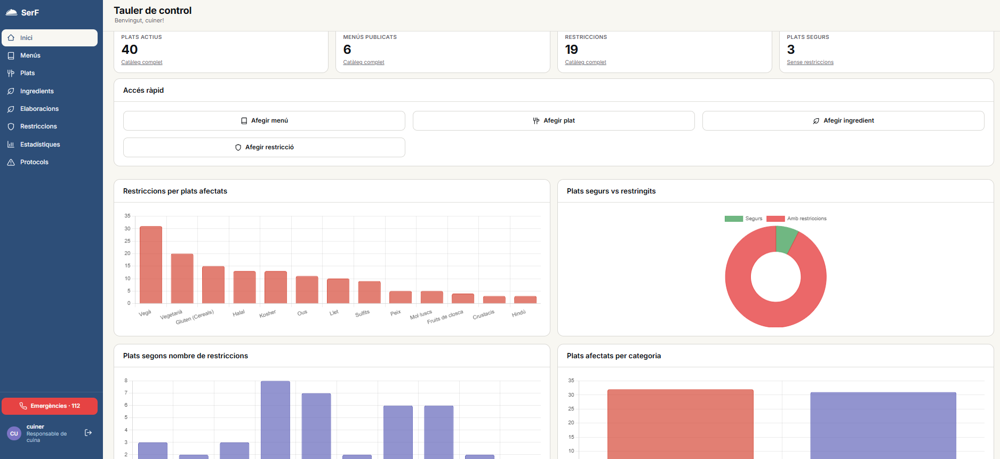
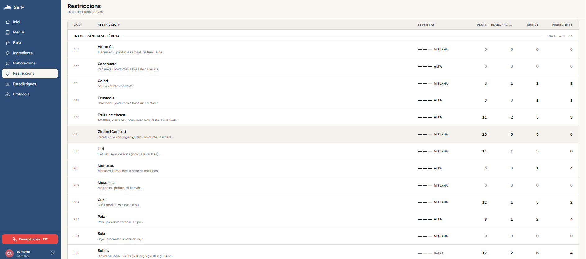
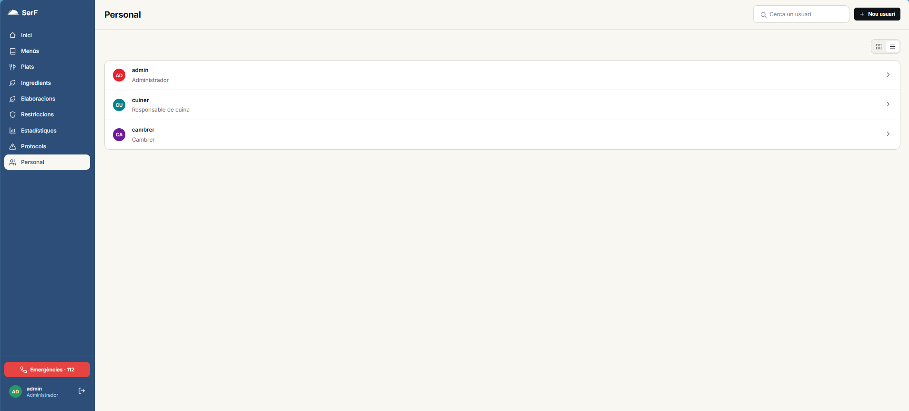
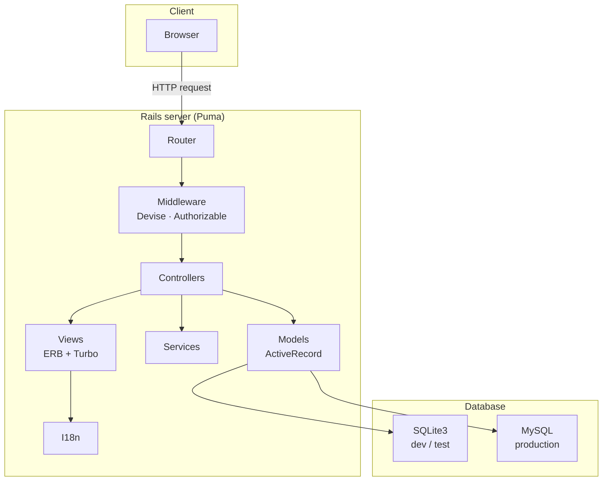

# Serf · Menu management for restaurants

**[English](#english) · [Català](#català)**

| Restrictions and their impact · Restriccions i el seu impacte | Staff and roles · Personal i rols |
|---|---|
|  |  |

> **Team project.** Serf was built by a team of 7 students for the course *Ampliació a l'Enginyeria del Programari* (AMEP) at the **UPC – EPSEVG** (Q2 2025-2026), for a **real client from the hospitality sector**. This is a personal copy of the team repository, kept with its full history and authorship. See [Team](#team) and [My contributions](#my-contributions).

---

## English

### The problem
When a group arrives at a restaurant with different dietary restrictions (allergies, intolerances, religious or personal diets), building a compatible menu by hand is slow and error-prone. Serf helps restaurant staff do it quickly and safely.

### Features
- **Catalogue management**: menus, dishes, elaborations, ingredients and restrictions, plus food-safety protocols.
- **Safe search**: inclusion, exclusion and category filters on dishes and menus, kept in the URL so a filtered view can be reloaded or shared.
- **Alternatives**: an algorithm that suggests substitutions on the spot when an ingredient of a dish can be replaced or dropped.
- **Statistics dashboard**: a quick overview of the strengths and weaknesses of the catalogue in terms of food accessibility.
- **Roles**: administrator, kitchen manager and waiter, each with its own permissions.
- **Responsive UI**, Catalan and English translations, and a direct call button to the emergency number 112.

### How we worked
We followed **Scrum** over an inception phase and **3 iterations**, with a real client giving feedback at the end of each one.

- **Ceremonies**: sprint planning, daily scrums, sprint review with a demo for the client, and a retrospective that changed the process for the next iteration.
- **Taiga**: epics and user stories with story points, split into 3-4 tasks each (*in progress → ready for test → done*). We used the Learning Dashboard to balance the workload.
- **Git workflow**: one branch per user story from `develop`, a **pull request reviewed by a different team member** before merging, and `develop → main` only at the end of each iteration. `git push --force` was banned on shared branches.
- **Definition of Done**:
  - Acceptance criteria met.
  - Automated tests added and passing.
  - No style issues (Rubocop) and no security warnings (Brakeman).
  - Code reviewed, UI checked against the agreed design, CI pipeline green.
  - Accepted by the iteration lead.
- **Continuous integration** with GitHub Actions: Brakeman, `importmap audit`, Rubocop and the test suite on every push, plus Dependabot.
- **AI-assisted development**: plan-first workflow (the plan is reviewed before any code is written, then tests first, then code that the developer reads and approves). Documented in `CLAUDE.md` and `doc/agents/`.

### Architecture
Monolithic **MVC** Rails application with server-side rendering (ERB + Turbo); there is no separate frontend or REST API.

More detail in [`doc/architecture/`](doc/architecture/) (database schema and class diagram).

### Tech stack
Ruby 3.1 · Rails 7.2 · Hotwire (Turbo, Stimulus) · Importmap · Chart.js · Devise · SQLite / MySQL · Minitest + Capybara/Selenium · Rubocop · Brakeman · GitHub Actions · Dependabot · Taiga

### Running it
See [`doc/setup.md`](doc/setup.md) for the full setup guide (Ruby with rbenv, dependencies, database and tests).

### My contributions
I was the team's **iteration planning lead**: I ran the sprint planning meetings and wrote the planning report for each iteration (goals, backlog with story points and work assignment).

As a developer:
- **Iteration 1**: models, tables and routes for **ingredients** and **restrictions**, and ingredient editing.
- **Iteration 2**: the full **dishes CRUD**, back end and front end (model and migration, dish-type enum, routes, controller, views and unit tests).
- **Iteration 3**: the **statistics section**, end to end (controller, data endpoint and first version of the view), which the team later extended with Chart.js charts and brought into the home dashboard; and the **reclassification of restriction categories** requested by the client. I also presented the kitchen manager's part of the final demo.

---

## Català

### El problema
Quan un grup arriba a un restaurant amb restriccions alimentàries diverses (al·lèrgies, intoleràncies, dietes religioses o personals), fer un menú compatible a mà és lent i propens a errors. Serf ajuda el personal del restaurant a fer-ho de manera ràpida i segura.

### Funcionalitats
- **Gestió del catàleg**: menús, plats, elaboracions, ingredients i restriccions, a més de protocols de seguretat alimentària.
- **Cerca segura**: filtres d'inclusió, d'exclusió i de categoria a plats i menús, que es guarden a l'URL perquè una vista filtrada es pugui recarregar o compartir.
- **Alternatives**: un algorisme que suggereix substitucions al moment quan un ingredient d'un plat es pot canviar o treure.
- **Panell d'estadístiques**: una visió ràpida dels punts forts i febles del catàleg pel que fa a accessibilitat alimentària.
- **Rols**: administrador, responsable de cuina i cambrer, cadascun amb els seus permisos.
- **Interfície responsive**, traduccions al català i a l'anglès, i botó de trucada directa al 112.

### Com hem treballat
Hem seguit **Scrum** en una fase d'incepció i **3 iteracions**, amb un client real que donava retroacció al final de cadascuna.

- **Cerimònies**: sprint planning, daily scrums, sprint review amb demo per al client i retrospectiva que canviava el procés de la iteració següent.
- **Taiga**: èpiques i històries d'usuari amb story points, dividides en 3-4 tasques (*in progress → ready for test → done*). Fèiem servir el Learning Dashboard per equilibrar la càrrega de feina.
- **Flux de Git**: una branca per història d'usuari a partir de `develop`, un **pull request revisat per un altre membre** abans de fer merge, i `develop → main` només en acabar cada iteració. `git push --force` prohibit a les branques compartides.
- **Definition of Done**:
  - Criteris d'acceptació complerts.
  - Tests automàtics nous i en verd.
  - Sense problemes d'estil (Rubocop) ni avisos de seguretat (Brakeman).
  - Codi revisat, interfície coherent amb el disseny acordat i pipeline de CI en verd.
  - Acceptada pel responsable de la iteració.
- **Integració contínua** amb GitHub Actions: Brakeman, `importmap audit`, Rubocop i els tests a cada push, a més de Dependabot.
- **Desenvolupament assistit per IA**: primer el pla (es revisa abans d'escriure codi), després els tests i després el codi, que el desenvolupador llegeix i aprova. Documentat a `CLAUDE.md` i `doc/agents/`.

### Arquitectura
Aplicació Rails **MVC** monolítica amb renderització al servidor (ERB + Turbo), sense frontend separat ni API REST. Diagrama a la secció anglesa i més detall a [`doc/architecture/`](doc/architecture/).

### Posada en marxa
Vegeu [`doc/setup.md`](doc/setup.md).

### La meva aportació
He estat el **responsable de la planificació de les iteracions**: conduïa les reunions de sprint planning i redactava l'informe de planificació de cada iteració (objectius, backlog amb story points i repartiment de la feina).

Com a desenvolupador:
- **Iteració 1**: models, taules i rutes d'**ingredients** i **restriccions**, i l'edició d'ingredients.
- **Iteració 2**: el **CRUD complet de plats**, backend i frontend (model i migració, enum de tipus de plat, rutes, controlador, vistes i tests unitaris).
- **Iteració 3**: l'**apartat d'estadístiques** de cap a peus (controlador, endpoint de dades i primera versió de la vista), que l'equip va ampliar després amb gràfics de Chart.js i va portar al tauler d'inici; i la **reclassificació de les categories de restriccions** que va demanar el client. També vaig presentar la part del responsable de cuina a la demo final.

---

## Team

| Member | Role in the team |
|---|---|
| Néstor Alonso López | Inception lead |
| Jean Carlos Cardenas Paucar | Iteration 3 lead |
| Arnau Castillo Moyano | Iteration 2 lead |
| **Magí Garcia Bedós** | **Iteration planning lead** |
| Guillem Lago Bonilla | Demo lead |
| Sofía Peña Narváez | Final report and presentation |
| Thomas Scalise Belusini | Iteration 1 lead |

Original repository: `AMEP-EPSEVG/Serf-APP` (private).
