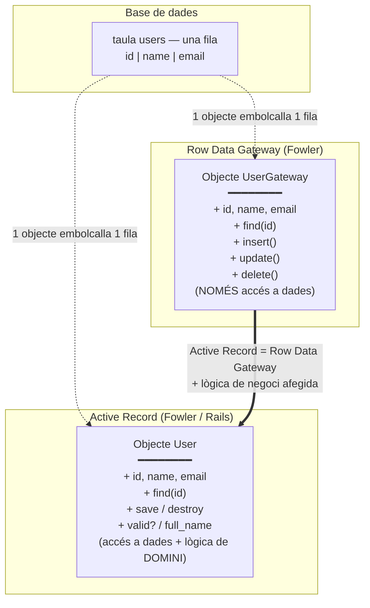

# Patró Active Record i la seva relació amb Row Data Gateway

Aquest diagrama mostra com tots dos patrons (definits per Martin Fowler a *Patterns of
Enterprise Application Architecture*) embolcallen una única fila d'una taula de la base de
dades, i com l'Active Record és, essencialment, un Row Data Gateway que a més incorpora la
lògica de domini.

## Idea clau

L'**Active Record *és* un Row Data Gateway amb la lògica de domini integrada dins el mateix
objecte**. Tots dos ofereixen un objecte que es correspon un a un amb una fila de la taula i
que sap carregar-se i desar-se. El Gateway s'atura aquí (és una capa fina d'accés a dades que
acompanyaries amb un objecte de domini separat), mentre que l'Active Record també porta les
regles de negoci de l'entitat — exactament el que fan els models de Rails com `User` o
`Elaboration` (`validates`, associacions, mètodes d'instància al costat de `save`/`find`).